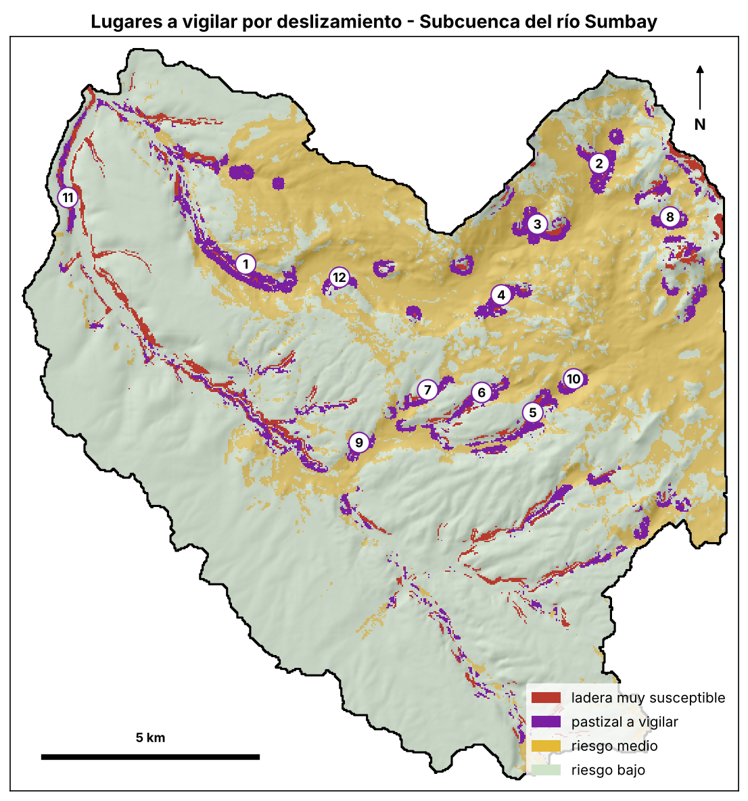

# T06.1 · Riesgo por deslizamiento (SAT) · subcuenca del río Sumbay (Imata)

Resultados del cuaderno `S09.1_Deslizamiento_Sumbay.ipynb` (semana 9, caso 2). Malla de 30 m, EPSG:32719.
Susceptibilidad = 0,5 · pendiente + 0,3 · cobertura + 0,2 · distancia al cauce (puntajes 1 a 5).
Amenaza = susceptibilidad máxima a 150 m. Riesgo = amenaza × vulnerabilidad.

| Archivo | Contenido |
|---|---|
| `S09_susceptibilidad_sumbay.tif` | Susceptibilidad continua (1 a 5) |
| `S09_susceptibilidad_clases_sumbay.tif` | Clases: 1 baja, 2 media, 3 alta, 4 muy alta |
| `S09_amenaza_deslizamiento_sumbay.tif` | Amenaza (susceptibilidad máxima en 150 m) |
| `S09_vulnerabilidad_sumbay.tif` | Vulnerabilidad por cobertura (pastizal 3, bofedal 2, construido 5, resto 1) |
| `S09_semaforo_deslizamiento_sumbay.tif` | Riesgo en semáforo: 1 bajo, 2 medio, 3 alto |
| `S09_susceptibilidad_alta_sumbay.geojson` | Polígonos de susceptibilidad alta o muy alta |
| `S09_zonas_a_vigilar_deslizamiento_sumbay.geojson` | Polígonos de pastizal al pie de laderas muy susceptibles |
| `S09_lugares_laderas_sumbay.csv` / `.geojson` | Las 12 manchas mayores a vigilar, con nombre (OpenStreetMap) |
| `S09_resumen_susceptibilidad_sumbay.csv` | Superficie por clase de susceptibilidad |
| `S09_resumen_riesgo_deslizamiento_sumbay.csv` | Superficie por clase de riesgo |
| `S09_sensibilidad_pesos_sumbay.csv` | Comparación de pesos 0,5/0,3/0,2 frente a 0,4/0,4/0,2 |
| `S09_aviso_laderas_sumbay.txt` | Texto del aviso del SAT |
| `S09_fig1` … `S09_fig4` (`.png`) | Capas condicionantes, susceptibilidad, riesgo y lugares a vigilar |

## Resumen

| Clase | ha | % cuenca |
|---|---|---|
| baja | 2 562 | 13,5 |
| media | 13 980 | 73,4 |
| alta | 2 045 | 10,7 |
| muy alta | 450 | 2,4 |

Riesgo alto: 0 ha (WorldCover no detecta construcciones). Pastizal a vigilar: 110 manchas de al menos 1 ha, 817 ha.



## Aviso generado

```
SUBCUENCA DEL RÍO SUMBAY (IMATA) · LADERAS
Pronóstico: 32.2 mm en 72 horas (34% de la lluvia máxima registrada, 94 mm en 3 días)
Vigilancia: BAJA: sin acción especial por lluvia
```

Mapa de susceptibilidad calculado en clase, sin validar con deslizamientos reales; no es una alerta oficial.
